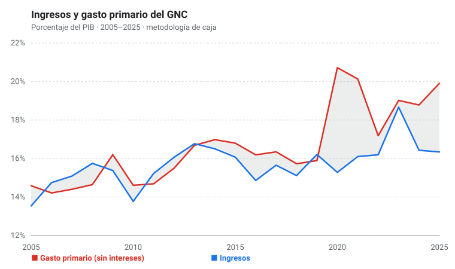
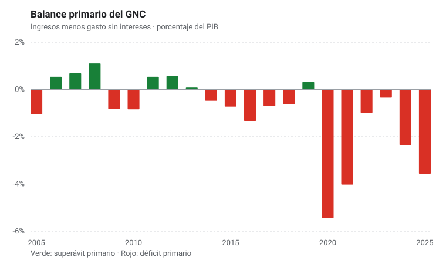

+++
date = '2026-10-05T14:30:00-05:00'
lastmod = '2026-11-21T13:30:00-05:00'
draft = true
title = 'Los ingresos subieron, pero el gasto subió más.'
slug = 'ingresos-y-gasto-gnc'
resaltado = 'pero el gasto subió más.'
summary = 'Veinte años de cuentas del Gobierno Nacional Central se pueden resumir en que el recaudo creció 2,8 puntos del PIB desde 2005 y el gasto sin intereses creció 5,3 puntos. La brecha no se cerró ni en el mejor año de recaudo de toda la serie.'
tags = ['fiscal', 'gnc', 'deficit', 'series-historicas']
tema = 'Finanzas públicas'
datos = 'ingresos-gasto-gnc.csv'
serie = 'Ingresos y gasto primario del GNC, 2005–2025'
estado = 'cerrada'

[ficha]
fuente = 'MinHacienda · Banco de la República'
deflactor = 'DANE'
metodologia = 'Caja, totales anuales'
cobertura = '2005–2025'

[validacion]
contra = 'ESPE 90 y Borrador de Economía 1136 del Banco de la República'
cifra = '≤ 0,2 pp'
alcance = 'de diferencia en ingresos, gastos y balance total'
+++

Buena parte de la discusión fiscal colombiana se juega sobre una premisa que
rara vez se verifica: que el déficit existe porque el Estado no recauda lo
suficiente. Y la premisa contraria circula con la misma soltura: que el gasto
crece (gran tamaño del Estado) sin fundamentos técnicos.

Pero las series del Ministerio de Hacienda desde 2005 permiten revisar las dos,
y lo que muestran no favorece a ninguna del todo, aunque sí ordena las
magnitudes.

## Dos líneas que dejaron de moverse juntas

Los ingresos del Gobierno Nacional Central
pasaron de **13,5% del PIB en 2005 a 16,3% en 2025**: subieron 2,8 puntos
porcentuales en veinte años. Es un crecimiento lento pero sostenido, a pesar de
aprobar reformas tributarias cada 18 meses en promedio.

Por su parte, el gasto primario
(el gasto total menos los intereses de la deuda) pasó de **14,6% a 19,9% del
PIB** en el mismo periodo, una subida de 5,3 puntos porcentuales. Casi el
doble.

Lo que la gráfica muestra es que hasta 2019 las dos líneas se persiguen. La
brecha entre ellas se mantiene dentro de un punto del PIB y **cambia de signo
siete veces**: en 2006, 2007, 2008, 2011, 2012, 2013 y 2019, cuando el Gobierno
gastó menos de lo que recaudó, sin contar el pago de intereses. Eso es un
superávit primario, y durante buena parte de dos décadas fue algo normal para
Colombia.

En 2020 las líneas se separan. El gasto primario salta a 20,7% del PIB y los
ingresos caen a 15,3%. Hasta ahí, nada sorprendente, porque así se ve una
pandemia en las cuentas públicas de cualquier país.

## La prueba de 2023

En 2023 los ingresos se recuperaron; incluso **fue el mejor año de recaudo de
toda la serie**, con 18,7% del PIB, dos puntos por encima del promedio de las
dos décadas anteriores.

Y aun así el balance primario
de 2023 fue negativo, −0,35% del PIB, porque en el año de mayor recaudo
registrado el Gobierno todavía gastó más de lo que recibió, aun excluyendo los
intereses de la deuda.

Para 2025 los ingresos volvieron a su nivel habitual de 16,3% del PIB, mientras
el gasto primario se quedó en 19,9% (prácticamente el pico pandémico), con lo
que la brecha es de 3,6 puntos del PIB y lleva seis años consecutivos sin
cerrarse. Es la racha de déficit primario más larga de la serie.

Conviene insistir en que todo esto excluye los intereses, así que el déficit
total es mayor. En 2025, en
metodología de caja, fue
de $107,6 billones, y la deuda bruta del Gobierno Nacional Central pasó del
registro mínimo de 32,7% del PIB en 2012 a **62,9% en 2025**.

Este ejercicio nos permite ver cómo los ingresos tienen un ritmo de crecimiento
distinto al de los gastos, lo cual se puede configurar como el patrón
estructural de las finanzas públicas del país. Es lo que hace que se hagan
reformas tributarias tan seguidas, generando y cambiando cada dos años los
contextos de información para los mercados, internos y externos, y afectando
tasas y otros indicadores. Colombia adolece de falta de consistencia en su
política fiscal. A manera de pregunta: ¿los periodos de superávit responden a
un comportamiento estructural de los ingresos o son el resultado de momentos y
coyunturas concretas de los mercados, como un *boom* en los precios del
petróleo?

## Cuatro advertencias

**Caja no es causación.** Las cifras oficiales de sostenibilidad usan
contabilidad de causación; estas
registran cuándo entra y sale el dinero. La diferencia es pequeña en ingresos y
gastos totales, pero alcanza algunas décimas en el balance primario: en 2011
incluso cambia de signo. Para afirmaciones sobre sostenibilidad de la deuda,
las cifras oficiales mandan.

**Los intereses de 2025 no son comparables.** La serie de caja registra valores
negativos en agosto y octubre de 2025, típicos de operaciones de tesorería que
netean contra el costo de la deuda. Por eso este artículo trabaja con gasto
primario: como el gasto primario es el gasto total menos los intereses, la
cifra no depende de cómo se clasifiquen esas operaciones entre un rubro y otro.
El déficit total de 2025 sí las incorpora y debe leerse con esa salvedad.

**2004 y 2026 quedan fuera.** Para 2004 el DANE no publica PIB en la base
vigente; 2026 solo tiene seis meses.

**Los años recientes son provisionales.** El PIB nominal de los últimos
ejercicios es preliminar y se revisa, lo que mueve ligeramente todas las
razones calculadas sobre él.
