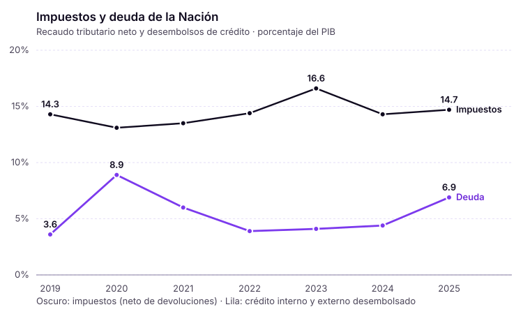
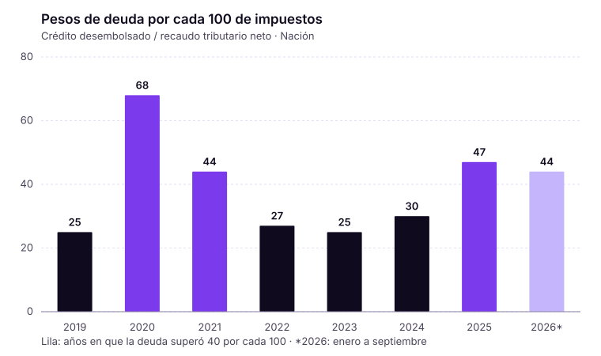

+++
date = '2026-11-02T20:00:00-05:00'
draft = true
title = 'Por cada 100 pesos de impuestos, 47 de deuda.'
slug = 'impuestos-y-deuda-2019-2026'
resaltado = '47 de deuda.'
summary = 'En 2025 la Nación recibió de crédito tanto como en la pandemia, en pesos de hoy, mientras el recaudo tributario real sigue por debajo de 2023. Lo dicen 1,4 millones de registros mensuales del presupuesto, de 2019 a septiembre de 2026.'
tags = ['fiscal', 'deuda', 'impuestos', 'presupuesto']
tema = 'Finanzas públicas'
datos = 'impuestos-vs-deuda-2019-2026.csv'

[ficha]
fuente = 'MinHacienda (datos.gov.co) · DIAN'
deflactor = 'DANE'
metodologia = 'Recaudo efectivo en caja, acumulado a diciembre'
cobertura = '2019–sep. 2026'

[validacion]
contra = 'Recaudo bruto mensual de la DIAN, corte 23-oct-2026'
cifra = '4–7 %'
alcance = 'de diferencia anual, explicada por los pagos en TIDIS; misma trayectoria en las dos series'
+++

En 2019, por cada 100 pesos que la Nación recibió en impuestos, recibió 25 en
préstamos. En 2020, el año de la pandemia, fueron 68. En 2025, sin pandemia,
fueron 47. Y 2026 va, a septiembre, en 44.

Esa cifra resume este análisis. Sale de un registro poco usado: el detalle
mensual de los ingresos del Presupuesto General de la Nación, entidad por
entidad y rubro por rubro, que el Ministerio de Hacienda publica en datos
abiertos. Son 1,4 millones de filas desde enero de 2019. Aquí se leen dos de
sus ramas: lo que entra por impuestos y lo que entra por crédito.

## El récord que no es

En pesos corrientes, 2025 fue el año de mayor recaudo tributario de la
historia: **272 billones de pesos**, netos de devoluciones. Pero un peso de
2025 compra menos que uno de 2023, y el PIB también creció. Medido como debe
medirse, el recaudo de 2025 no es un récord.

En pesos de 2025, el recaudo
de 2023 fue de 295 billones; el de 2025, 272. Un **8 % menos** que dos años
antes, y apenas por encima de 2022. Como porcentaje del PIB, los impuestos
fueron 16,6 % en 2023, cayeron a 14,3 % en 2024 y se recuperaron a 14,7 % en
2025. En 2019 eran 14,3 %: seis años después, la Nación recauda en impuestos la
misma proporción de la economía.

El pico de 2023 tiene nombre propio: la declaración anual de renta. La serie
de la DIAN separa el impuesto de renta en dos partes: las retenciones, que se
cobran mes a mes sobre la actividad del año corriente, y las cuotas, que se
pagan al declarar las utilidades del año anterior. Las retenciones crecieron
parejo: 79 billones en 2022, 96 en 2023, 98 en 2024. Las cuotas saltaron de
24 billones en 2022 a **51 en 2023** y volvieron a 30 en 2024. Lo que se
declaró en 2023 fueron las utilidades de 2022, el año de los precios altos del
petróleo y el carbón, con las tarifas de la reforma de ese año. En 2024 esa
base desapareció, y la caída del recaudo (12 billones) es, toda, caída de
cuotas (21 billones): el resto subió.

La serie oficial de la DIAN cuenta la misma historia: −4,3 % en 2024 y +10 % en
2025, con un cierre de **294,5 billones brutos**. La diferencia con la cifra
de este análisis tiene una explicación y está más abajo.

En 2026, a septiembre, los impuestos crecen: 5,5 % según la DIAN, 9,4 % según
el registro presupuestal. Lo que ninguna de las dos fuentes muestra es un salto
que devuelva el recaudo al nivel de 2023.

## 2025 igualó a la pandemia

Los recursos de crédito
son lo que la Nación recibe cuando se endeuda: la venta de TES en el mercado
interno y los desembolsos de préstamos y bonos en el exterior. No son ingresos
en el sentido corriente, porque hay que devolverlos, pero el presupuesto los
registra como ingresos y con ellos se paga gasto.

En 2019 la Nación recibió 38 billones de crédito. En 2020, 89. Luego bajó: 72,
57, 66 y 75 billones entre 2021 y 2024. **En 2025 recibió 129 billones.** En
pesos de 2025 es lo mismo que en 2020 (127). Como porcentaje del PIB, 6,9 %, el
segundo registro de la serie después del 8,9 % de la pandemia.

El salto es de crédito interno: **86 billones en 2025 contra 48 en 2024**, un
80 % más. El crédito externo también subió, de 27 a 43.

Una explicación posible era que el Gobierno hubiera adelantado en noviembre y
diciembre de 2025 deuda destinada a 2026. Los datos mensuales la descartan: el
último bimestre de 2025 aportó el 11 % del crédito del año, contra el 26 % en
2023 y en 2024. El endeudamiento de 2025 se repartió a lo largo del año, con
picos en abril y septiembre.

Y 2026 empezó más rápido: **40 billones de crédito en enero y febrero**, el
doble que en el mismo bimestre de 2025. A septiembre lleva 101 billones, la
misma cifra que 2025 a esa altura.

## La razón entre las dos

Poner una cifra sobre la otra tiene una ventaja: no hace falta deflactar ni
dividir por el PIB, porque las dos están en los mismos pesos del mismo año.
Por cada 100 pesos de impuestos, la Nación recibió de deuda 25 en 2019, 68 en
2020, 44 en 2021, 27 en 2022, 25 en 2023, 30 en 2024, **47 en 2025** y 44 en
lo que va de 2026.

Entre 2022 y 2024 la razón volvió al nivel de antes de la pandemia. En 2025 se
fue a 47 y en 2026 se sostiene en 44. Dos años seguidos con la deuda cerca de
la mitad de los impuestos, sin un choque externo que lo explique, no es un
dato suelto. Es un cambio de régimen.

## Lo que estas cifras no dicen

En junio de 2025 el Gobierno activó la
cláusula de escape de la
regla fiscal, que suspende por
tres años las metas de déficit y deuda. El Comité Autónomo de la Regla Fiscal
emitió concepto desfavorable: en su lectura, la situación no era el evento
extraordinario que la ley exige para suspender la regla, y el plan de ajuste
del Ministerio no bastaba para estabilizar la deuda. El déficit proyectado para
2025 era de 7,1 % del PIB.

Estos registros muestran la contraparte de ese déficit en la caja: el crédito
que entró para cubrirlo. No muestran en qué se gastó, ni si la deuda de 2025
fue cara o barata, ni cuánto de ella vence pronto. Tampoco dicen si el recaudo
debería ser mayor: eso depende de qué impuestos crecen con la economía y
cuáles dependen de un buen año del petróleo, que es la pregunta de la próxima
pieza.

Lo que sí establecen es una proporción. En 2025 y 2026, de cada tres pesos que
entraron a la Nación por impuestos y crédito, uno fue prestado.

## Cómo se construyeron estas cifras

La fuente es el conjunto **«Ingresos Desagregados por Vigencia»** del
Ministerio de Hacienda, en el portal de datos abiertos del Gobierno, descargado
el 2 de noviembre de 2026: 1.415.617 filas, de enero de 2019 a septiembre de
2026. Registra, para cada entidad, mes, rubro y fuente de financiación, lo
presupuestado y lo efectivamente recaudado, con acumulados dentro de cada año.

«Impuestos» es la rama de ingresos tributarios de la Nación, neta de las
devoluciones pagadas en efectivo. «Deuda» es la suma de los rubros de crédito
interno y crédito externo. Las cifras anuales son el acumulado a diciembre; las
de 2026, el acumulado a septiembre. El IPC y el PIB nominal son del DANE, los
mismos del análisis anterior.

El archivo tiene estructura de árbol: cada rubro aparece con sus subtotales, y
sumarlo todo cuenta el mismo peso varias veces. Se sumaron solo los nodos
terminales —los códigos sin desagregación por debajo, dentro de cada entidad y
mes— y se excluyó el catálogo de encabezados. La regla se verificó contra los
totales del propio archivo: en 300 de 314 ramas entidad-rubro de diciembre de
2025 coincide al peso, y la diferencia neta es de 0,001 %.

Hay cuatro advertencias que conviene no saltarse:

**Caja no es lo que publica la DIAN.** La serie oficial de
recaudo bruto de la DIAN da
294,5 billones para 2025; este análisis, 273,1 brutos. La diferencia es
estructural, de entre 4 % y 7 % cada año desde 2019, y la explicación
consistente está en la definición: la DIAN cuenta el recaudo «en efectivo y en
papeles», es decir, incluye los pagos con
TIDIS, que no entran como efectivo a la
Tesorería. No se verificó cifra por cifra contra el monto de TIDIS de cada año.
Las dos series tienen la misma forma: pico en 2023, caída en 2024, rebote en
2025.

**2026 crece distinto en cada fuente.** A septiembre, la DIAN crece 5,5 % y el
registro presupuestal 9,4 %; la brecha entre ambas se redujo a 3,6 %. Es rezago
de caja o menos pagos en papeles, y no se puede distinguir todavía. Para el
crecimiento de 2026, la cifra de la DIAN es la prudente.

**2026 va solo en pesos corrientes.** No hay IPC ni PIB completos del año, así
que 2026 aparece en la razón deuda/impuestos, que no los necesita, y en pesos
corrientes comparados contra enero–septiembre de 2025.

**Esto no es todo lo que entra.** Quedan fuera los ingresos propios de los
establecimientos públicos, los fondos especiales (donde se registró el FOME en
2020 y 2021), las contribuciones parafiscales y los
recursos de capital
distintos del crédito: dividendos de Ecopetrol, excedentes, reintegros. Todos
están en el archivo y se suman con la misma regla.
