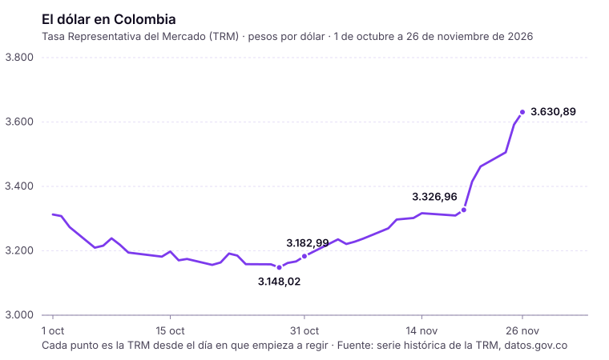

+++
date = '2026-11-26T11:30:00-05:00'
draft = false   # aprobado por Felipe el 26-nov-2026, 13:06
title = '¿Qué le pasa al dólar? ¿Quién tiene la culpa?'
slug = 'que-le-pasa-al-dolar'
resaltado = '¿Quién tiene la culpa?'
summary = 'En noviembre el dólar pasó de $3.200 a $3.600 y el peso perdió 11% de su valor. No hay un solo culpable: pesan la Reserva Federal, el nerviosismo por la inteligencia artificial, el petróleo y las dudas sobre el ajuste fiscal en Colombia.'
tags = ['dolar', 'tasas', 'deficit']
tema = 'Dólar y tasas'
datos = 'trm-oct-nov-2026.csv'
serie = 'TRM diaria, octubre y noviembre de 2026'
estado = 'cerrada'
datos_nota = 'Cada fila es una TRM con los días en que rige; corte al 26 de noviembre de 2026.'
# Texto tal como llegó (26-nov-2026), por decisión de Felipe; de la revisión solo entraron el cargo de
# José Ignacio López (presidente de ANIF), la gráfica de la TRM y los enlaces (glosario, Depende, BBC).
# La captura del trino la envió Felipe: excepción a S7 decidida por él («costumbre de medios»).
# Cotejo de la serie: la TRM del 14–17 nov ($3.316,70) y la del 18 nov ($3.309,55) coinciden con las
# que publicaron El Colombiano (17-nov) y La República (18-nov).

[ficha]
fuente = 'Serie histórica de la TRM (datos.gov.co)'
metodologia = 'TRM por fecha de vigencia'
cobertura = '1 oct.–26 nov. 2026'
+++

Durante noviembre, el valor del dólar estadounidense en Colombia pasó de $3.200 a $3.600, es decir, en promedio, más de $100 por semana con lo que el país acumula una pérdida de valor de 11% frente a la divisa de Estados Unidos y se posiciona como la moneda latina de peor desempeño en el mes ¿por qué?

Como sucede siempre y en todos los países, es una mezcla de factores externos (lo que sucede en el mundo, especialmente en Estados Unidos) e internos (lo que pasa en Colombia). En esta ocasión, lo que más pesa son los factores externos liderados por unos datos económicos de Estados Unidos que hacen que los inversionistas den casi por seguro que la Reserva Federal, el Banco de la República de ese país, subirá las tasas de interés pronto.

Y a eso se suman el nerviosismo en los mercados por el riesgo a una burbuja en el sector de la Inteligencia Artificial, que lleva a los inversionistas a buscar refugios para su dinero, y el bajo precio del petróleo en medio del conflicto en Irán y la [reunión China-Estados Unidos-Rusia](https://www.bbc.com/mundo/articles/cw1md5mzjj4vo) en la que los tres presidentes se comprometieron a bajar el precio del crudo.

Con ese panorama, el centro de estudios ANIF calcula que el nuevo precio de equilibrio del dólar en Colombia podría estar más en los $4.000.

")

## El problema local

A todo eso se suma el momento que vive el país. Un dólar a $3.100 advertían los expertos, era demasiado barato para los fundamentales del país y estaba explicado principalmente por una tasa de interés local alta y las expectativas de ajuste fiscal.

Sin embargo, con el paso de los meses la inversión por la tasa de interés de 12,25% del Banco de la República ha perdido interés teniendo en cuenta que la Reserva Federal subiría sus tasas, lo que recortaría el diferencial entre ambos países que es lo que hace atractiva a Colombia con su mayor riesgo, pero más pago de rentabilidad. (Ver: [¿Sube el dólar esta semana? Depende.](/video/depende-dolar/))

Y, al mismo tiempo, los inversionistas han dejado el optimismo por las propuestas del nuevo gobierno para reemplazarlo por la exigencia de evidencias de un ajuste tanto en el recaudo como en el gasto público que sea coherente con la meta de reducción de la deuda pública y el déficit fiscal, proyectado en 7,2% para el cierre de este año, superior en 0,8 puntos porcentuales frente al 6,4% reportado en 2025.

## El futuro

Dicho de otra manera, el precio del dólar no es culpa de una sola persona sino de una serie de factores tanto internacionales como nacionales sobre los que, por ahora, hay pocas certezas.

Por eso, para el futuro, José Ignacio López, presidente de ANIF, resume así las apuestas por la tasa de cambio: "Si el contexto externo mejora y se disipan algunas incertidumbres locales, el equilibrio podría volver a $3.600–$3.700. El año entrante el influjo de divisas resultado de las necesidades de endeudamiento externo serán nuevamente un factor de apreciación".
